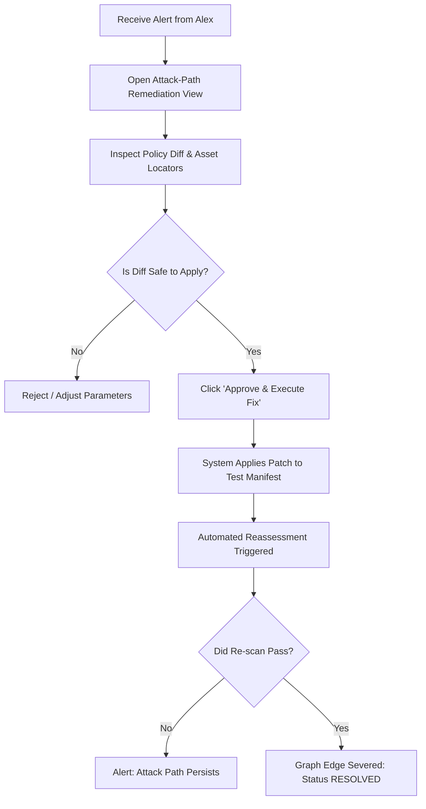

# User Journeys & Persona Workflows — Domain-Vihaan_X

> **Document ID:** JOURNEY-001  
> **Project Name:** Domain-Vihaan_X  
> **Domain:** Cybersecurity (VIHAAN X Hackathon)  
> **Document Status:** PROPOSED (Under Review by Core Team)  
> **Author:** Principal Product Manager & Technical Program Manager  
> **Last Updated:** 2026-11-14T23:34:00+05:30  

---

## 1. Overview and Priority Focus

This document outlines the detailed user journeys, system interactions, mental models, and failure states across four primary user personas.

For the **VIHAAN X Hackathon MVP**, **Persona 1 (SaaS Founder / CTO)** and **Persona 2 (Engineering Lead / DevOps)** are the primary target flows and represent the core live demonstration sequence. Persona 3 and Persona 4 represent post-hackathon roadmap expansions.

```
PRIORITY MATRIX:
┌───────────────────────────────────────────────┬────────────────────────────┐
│ Persona 1: Alex (SaaS Founder / CTO)          │ P0 — CORE HACKATHON FOCUS  │
│ Persona 2: Priya (Engineering Lead / DevOps)  │ P0 — CORE HACKATHON FOCUS  │
├───────────────────────────────────────────────┼────────────────────────────┤
│ Persona 3: Marcus (Security Operator)         │ P1 — Post-MVP Enhancement  │
│ Persona 4: Elena (Agency Account Lead)        │ P2 — Commercial Roadmap    │
└───────────────────────────────────────────────┴────────────────────────────┘
```

---

## 2. Persona 1: Alex — The SaaS Startup Founder / CTO

### Profile & Context
- **Role:** Co-Founder & CTO of "AcmeCloud", an 18-person B2B SaaS startup.
- **Environment:** Monorepo on GitHub, AWS infrastructure (S3, ECS, RDS), Cloudflare DNS.
- **Mental Model:** Focuses on business risk, customer trust, compliance (SOC2 readiness), and keeping engineering velocity high. Does not have time to review 400-line scanner logs.

---

### Journey 1A: Executive Posture Assessment & Attack-Path Discovery (P0)

```
[Start: Monday Morning Review]
      │
      ▼
1. Log into Dashboard ──► System renders executive risk posture (Score: 8.4/10 HIGH)
      │
      ▼
2. Inspect "Critical Attack Paths" ──► Graph shows 1 active cross-domain exploit chain
      │
      ▼
3. Click "Explain Path" ──► AI summarizes business impact in plain English
      │
      ▼
4. Delegate / Authorize Remediation ──► Notifies Lead Engineer (Priya) with actionable diff
```

#### Step-by-Step Flow

1. **Initial State:**
   - Alex opens the Domain-Vihaan_X web dashboard after an automated overnight security assessment.
   - The platform displays an aggregate Risk Score of **8.4 / 10 (Critical)** with 1 active critical attack path detected.

2. **User Action:**
   - Alex clicks on the high-priority alert card: **"Active Attack Path: Public Ingress to Production Backup Storage"**.

3. **System Response:**
   - The UI transitions to the **Business Security Graph** view.
   - The graph automatically centers and highlights a 4-node attack chain in pulsating red:
     - `Node 1 (Repository)`: `acme-backend-api` (Source Code)
     - `Node 2 (Finding)`: Hardcoded AWS access key in `config/staging.env` (Gitleaks)
     - `Node 3 (Asset)`: IAM Role `arn:aws:iam::123456789012:role/StagingDeployer` with `s3:*` policy (Checkov)
     - `Node 4 (Asset)`: Cloud Storage Bucket `s3://acme-prod-db-backups` (Trivy IaC)
   - A side panel renders an **Evidence-Grounded AI Summary**:
     > *"A developer committed AWS staging credentials into repository `acme-backend-api`. However, the associated IAM role possesses unrestricted wildcard permissions (`s3:*`) across all accounts, granting full read access to your production customer database backup bucket `acme-prod-db-backups`. An external attacker finding this secret can exfiltrate your entire customer database."*

4. **Expected Result:**
   - Alex immediately understands the business risk without reading raw JSON files or deciphering complex IAM JSON syntaxes.
   - Alex clicks **"Generate Remediation Plan"** and forwards the action item to Lead Engineer Priya.

5. **Possible Failure States & Error Recovery:**
   - *Failure State:* LLM service timeout or unreachable external API.
   - *System Recovery:* The system falls back to a deterministic, rule-based template summary: *"Composite Attack Path: Leaked Credential [Gitleaks] -> Permissive IAM Role [Checkov] -> High-Value Cloud Storage [Trivy]. Action required: Restrict IAM permissions."*

---

## 3. Persona 2: Priya — The Software Engineering Lead / DevOps

### Profile & Context
- **Role:** Lead Backend & DevOps Engineer at AcmeCloud.
- **Environment:** Writes Terraform, manages Docker containers, reviews GitHub PRs.
- **Mental Model:** Deeply pragmatic. Wary of automated tools breaking production environments. Demands code diffs, exact file paths, and verifiable proof that a fix worked.

---

### Journey 2A: Technical Triage, Human Approval, and Reassessment (P0)



#### Step-by-Step Flow

1. **Initial State:**
   - Priya accesses the platform via the direct link sent by Alex: `/attack-paths/AP-001`.
   - The platform displays the technical evidence pane, including scanner stdout snippets, exact commit hash `bafab7b`, file path `terraform/iam.tf:42`, and target bucket ARN.

2. **User Action:**
   - Priya inspects the **Remediation Recommendation** card:
     - **Action Type:** IAM Policy Least-Privilege Scoping.
     - **Target File:** `terraform/iam_staging.tf`.
     - **Diff Preview:**
       ```diff
       - Resource: "*"
       + Resource: "arn:aws:s3:::acme-staging-assets/*"
       ```
   - Priya clicks the toggle: **"Simulate in Test Environment"**.

3. **System Response:**
   - The platform confirms that applying this patch restricts staging credentials exclusively to staging buckets while denying access to production backup buckets.
   - The platform presents an explicit confirmation modal:
     > **"Human Approval Required:**  
     > You are approving remediation action `REM-001`. This will update `iam_staging.tf` and trigger an immediate verification reassessment.  
     > [ Cancel ]   [ Approve & Execute Remediation ]"

4. **User Action:**
   - Priya clicks **"Approve & Execute Remediation"**.

5. **System Response:**
   - The backend records the approval audit event with Priya's user ID and timestamp.
   - The backend applies the fix to the test configuration.
   - The system transitions the assessment status to `REASSESSING`.
   - The Checkov and Trivy scanner runners automatically execute against the modified configuration.
   - **Verification Result:** The finding `CKV_AWS_62: S3 Bucket wildcard access` is cleared.
   - The Business Security Graph dynamically updates: the red attack edge between `StagingDeployer` and `acme-prod-db-backups` vanishes.
   - The status badge transitions to **`RESOLVED / ATTACK PATH SEVERED`**.

6. **Expected Result:**
   - Priya has fixed the vulnerability, verified the outcome, and recorded an auditable compliance trail in under 3 minutes without manual re-running of CLI tools.

7. **Possible Failure States & Error Recovery:**
   - *Failure State:* The applied patch causes a syntax error in the IaC configuration, or the scanner reports that the attack path remains active.
   - *System Recovery:* The platform displays an error banner: *"Reassessment Failed: Finding CKV_AWS_62 still detected. Attack path remains ACTIVE. Rollback available."* The status reverts to `REMEDIATION_FAILED` and prompts for manual developer intervention.

---

## 4. Persona 3: Marcus — The Developer & Security Operator

### Profile & Context
- **Role:** Security Operator / Full-Stack Developer at a growing fintech startup.
- **Environment:** Responsible for running periodic vulnerability scans, checking public DNS records, and inspecting open ports before major client releases.
- **Mental Model:** Wants to quickly register new external domains and APIs and verify that no test endpoints were left open to the public internet.

---

### Journey 3A: External Attack Surface Ingress Mapping (P1)

1. **Initial State:**
   - Marcus registers a new public staging subdomain: `staging-api.acmecloud.com` and its associated GitHub repository.
2. **User Action:**
   - Marcus clicks **"Run Surface Assessment"**.
3. **System Response:**
   - The platform orchestrates Subfinder and Nuclei (via the isolated execution adapter).
   - Findings normalized:
     - Subdomain enumerated: `staging-api.acmecloud.com`
     - Open service detected: Port `8080` (FastAPI Swagger Docs exposed publicly)
     - Repository finding: API documentation contains unauthenticated internal debug endpoints (`/debug/pprof`).
   - The Business Security Graph links the public domain node directly to the backend web service node and flags the exposed debug endpoint as a perimeter ingress vulnerability.
4. **Expected Result:**
   - Marcus reviews the ingress finding, flags it for IP-whitelisting before production deployment, and exports the asset inventory.
5. **Possible Failure States & Error Recovery:**
   - *Failure State:* Network timeout during DNS resolution or scanner rate limiting by external target.
   - *System Recovery:* Scanner adapter logs a graceful warning: *"Scan incomplete for staging-api.acmecloud.com (DNS timeout). Partial results preserved."* Finding status marked `PARTIAL_RESULTS`.

---

## 5. Persona 4: Elena — The Software Agency Lead

### Profile & Context
- **Role:** Managing Director at "CodeForge Agency", developing web and mobile apps for 12 corporate clients simultaneously.
- **Environment:** Multi-repository setup, varying client cloud accounts, rapid project onboarding and handoffs.
- **Mental Model:** Needs strict client separation, rapid client onboarding, and defensible security audit deliverables to prove that CodeForge delivers secure code.

---

### Journey 4A: Multi-Project Client Audit and Handoff (P2 - Roadmap)

1. **Initial State:**
   - Elena prepares to deliver a custom SaaS application to a client. The client demands proof of code and infrastructure security prior to final milestone sign-off.
2. **User Action:**
   - Elena selects client workspace: `Client-RetailMax`.
   - Elena triggers **"Full Scope Audit"** across the client's GitHub repo and Terraform infrastructure directory.
3. **System Response:**
   - The platform normalizes 14 findings into the client graph.
   - 2 low-risk dependency CVEs found; 0 high-risk attack paths found.
   - Overall posture score calculated at **9.6 / 10 (Secure)**.
4. **User Action:**
   - Elena clicks **"Export Client Security Verification Report"**.
5. **System Response:**
   - The platform generates a branded executive summary document detailing assets scanned, zero detected attack paths, and timestamped scanner logs proving clean assessment.
6. **Expected Result:**
   - Elena delivers the verification report to the client, securing milestone sign-off and eliminating dispute over code security.
7. **Possible Failure States & Error Recovery:**
   - *Failure State:* Client credentials invalid or expired.
   - *System Recovery:* System halts execution with clear diagnostic: *"Authentication to Client-RetailMax repository failed: Invalid GitHub App token. Assessment aborted safely."*
