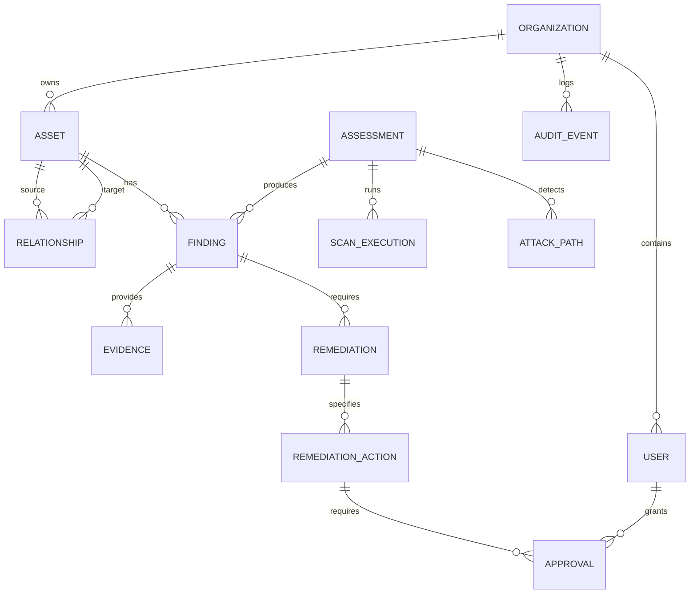

# Data Model & Schema Specification — Domain-Vihaan_X

> **Document ID:** DATA-001  
> **Project Name:** Domain-Vihaan_X  
> **Domain:** Cybersecurity (VIHAAN X Hackathon)  
> **Document Status:** PROPOSED (Under Review by Core Team)  
> **Author:** Principal Software Architect & Database Engineer  
> **Last Updated:** 2026-11-14T23:40:00+05:30  
> **Target Release:** Hackathon MVP (v0.1.0)  

---

## 1. Overview and Relational / Graph Duality

**Domain-Vihaan_X** relies on a dual-representation data architecture:
1. **Relational Model (SQLite in WAL mode for MVP):** Enforces ACID transactional integrity, maintains audit logs, stores user approvals, scan executions, raw telemetry evidence, and normalized finding records.
2. **Directed Property Graph Model (NetworkX in-memory for MVP):** Models the digital topology, asset dependencies, finding attachments, and attack path traversal calculations.

The schema is explicitly designed so that for production release v1.0, the relational entities map 1:1 to PostgreSQL tables, and the graph entities map cleanly to Neo4j or Memgraph nodes and relationships.

---

## 2. Entity-Relationship Diagram (Relational Core)



---

## 3. Entity Classification (MVP vs. Future Roadmap)

| Entity Name | Scope Tier | Storage Medium (MVP) | Storage Medium (v1.0 Production) |
| :--- | :--- | :--- | :--- |
| **Organization** | MVP (Single Org Default) | SQLite (`organizations`) | PostgreSQL (`organizations`) |
| **User** | MVP (Local Demo User) | SQLite (`users`) | PostgreSQL (`users` + Auth0 / Supabase) |
| **Asset** | **MVP Core** | SQLite (`assets`) | PostgreSQL + Neo4j Node (`:Asset`) |
| **Relationship** | **MVP Core** | SQLite (`relationships`) | Neo4j Edge (`:CONNECTED_TO`) |
| **Assessment** | **MVP Core** | SQLite (`assessments`) | PostgreSQL (`assessments`) |
| **ScanExecution** | **MVP Core** | SQLite (`scan_executions`) | PostgreSQL (`scan_executions`) |
| **Finding** | **MVP Core** | SQLite (`findings`) | PostgreSQL + Neo4j Node (`:Finding`) |
| **Evidence** | **MVP Core** | SQLite (`evidence`) | PostgreSQL / S3 Object Storage |
| **AttackPath** | **MVP Core** | SQLite (`attack_paths`) | PostgreSQL + Neo4j Path Cache |
| **Remediation** | **MVP Core** | SQLite (`remediations`) | PostgreSQL (`remediations`) |
| **RemediationAction** | **MVP Core** | SQLite (`remediation_actions`) | PostgreSQL (`remediation_actions`) |
| **Approval** | **MVP Core** | SQLite (`approvals`) | PostgreSQL (`approvals`) |
| **AuditEvent** | **MVP Core** | SQLite (`audit_events`) | PostgreSQL Partitioned / TimescaleDB |
| **Vulnerability** | Future (v0.2) | Denormalized into Finding | Dedicated CVE Master Table |
| **Risk** | Future (v0.2) | Computed property on Finding/Path| Historical Risk Time-Series Table |

---

## 4. Entity Specifications

### 4.1 Organization (`organizations`)
- **Purpose:** Represents the tenant boundary owning digital assets. For the MVP, a default tenant `ORG-DEFAULT` is initialized.
- **Fields:**
  - `id` (TEXT, PK): UUID format, e.g., `org_01h8x1...`
  - `name` (TEXT, NOT NULL): Organization display name, e.g., `Acme SaaS Inc.`
  - `slug` (TEXT, UNIQUE, NOT NULL): URL-safe identifier, e.g., `acme-saas`
  - `created_at` (TEXT, NOT NULL): ISO 8601 UTC timestamp.
- **Constraints:** Single organization enforced in MVP.

---

### 4.2 User (`users`)
- **Purpose:** Represents a human operator or service account capable of initiating assessments and approving remediations.
- **Fields:**
  - `id` (TEXT, PK): UUID format, e.g., `usr_01h8x2...`
  - `org_id` (TEXT, FK -> `organizations.id`, NOT NULL)
  - `email` (TEXT, UNIQUE, NOT NULL): Operator email address.
  - `name` (TEXT, NOT NULL): Full name.
  - `role` (TEXT, NOT NULL): Enum (`ADMIN`, `DEV_LEAD`, `OPERATOR`, `VIEWER`).
  - `created_at` (TEXT, NOT NULL): ISO 8601 UTC timestamp.

---

### 4.3 Asset (`assets`)
- **Purpose:** Primary digital asset entity registered for monitoring and security assessment.
- **Fields:**
  - `id` (TEXT, PK): Format `ast_<8-hex>`, e.g., `ast_a1b2c3d4`
  - `org_id` (TEXT, FK -> `organizations.id`, NOT NULL)
  - `name` (TEXT, NOT NULL): Human-readable name, e.g., `Backend API Repository`
  - `asset_type` (TEXT, NOT NULL): Enum (`REPOSITORY`, `CLOUD_STORAGE`, `IAM_ROLE`, `DOMAIN`, `WEB_SERVICE`)
  - `environment` (TEXT, NOT NULL): Enum (`PRODUCTION`, `STAGING`, `TESTING`, `DEVELOPMENT`)
  - `criticality` (TEXT, NOT NULL): Enum (`CRITICAL`, `HIGH`, `MEDIUM`, `LOW`)
  - `locator` (TEXT, NOT NULL): Path, URL, or identifier (e.g., `/mock_env/repo`, `s3://prod-backups`, `api.acme.com`)
  - `is_authorized` (INTEGER, NOT NULL, DEFAULT 1): Boolean flag indicating explicit scanning permission.
  - `metadata_json` (TEXT): JSON blob for tool-specific configuration.
  - `created_at` (TEXT, NOT NULL): ISO 8601 UTC timestamp.
  - `updated_at` (TEXT, NOT NULL): ISO 8601 UTC timestamp.
- **Constraints:** `UNIQUE(org_id, locator)`. Only authorized assets may be targeted by assessments.

---

### 4.4 Relationship (`relationships`)
- **Purpose:** Directed connection between two digital assets establishing topology and access pathways.
- **Fields:**
  - `id` (TEXT, PK): Format `rel_<8-hex>`
  - `source_asset_id` (TEXT, FK -> `assets.id`, NOT NULL)
  - `target_asset_id` (TEXT, FK -> `assets.id`, NOT NULL)
  - `relationship_type` (TEXT, NOT NULL): Enum (`DEPLOYS_TO`, `ASSUMES_ROLE`, `STORES_DATA_IN`, `EXPOSES_ENDPOINT`, `AUTHENTICATES_VIA`)
  - `provenance` (TEXT, NOT NULL): How this relationship was discovered: `CONFIG_DERIVED`, `SCANNER_VERIFIED`, `SEEDED_MANIFEST`, `MANUAL_DECLARED`.
  - `confidence_score` (REAL, NOT NULL, DEFAULT 1.0): Floating point between 0.0 and 1.0.
  - `created_at` (TEXT, NOT NULL): ISO 8601 UTC timestamp.
- **Constraints:** `UNIQUE(source_asset_id, target_asset_id, relationship_type)`. Self-referencing edges permitted only when technically justified.

---

### 4.5 Assessment (`assessments`)
- **Purpose:** An orchestrated security assessment run against a defined scope of assets.
- **Fields:**
  - `id` (TEXT, PK): Format `asm_<8-hex>`
  - `org_id` (TEXT, FK -> `organizations.id`, NOT NULL)
  - `name` (TEXT, NOT NULL): Assessment label, e.g., `Pre-Launch Full Security Audit`
  - `status` (TEXT, NOT NULL): Enum (`PENDING`, `RUNNING`, `COMPLETED`, `FAILED`, `CANCELLED`)
  - `total_findings_count` (INTEGER, DEFAULT 0)
  - `critical_findings_count` (INTEGER, DEFAULT 0)
  - `attack_paths_count` (INTEGER, DEFAULT 0)
  - `started_at` (TEXT): ISO 8601 UTC timestamp.
  - `completed_at` (TEXT): ISO 8601 UTC timestamp.
  - `created_at` (TEXT, NOT NULL): ISO 8601 UTC timestamp.

---

### 4.6 ScanExecution (`scan_executions`)
- **Purpose:** Record of an individual CLI scanner invocation (e.g., Gitleaks run against a specific repository).
- **Fields:**
  - `id` (TEXT, PK): Format `scx_<8-hex>`
  - `assessment_id` (TEXT, FK -> `assessments.id`, NOT NULL)
  - `asset_id` (TEXT, FK -> `assets.id`, NOT NULL)
  - `tool_name` (TEXT, NOT NULL): Enum (`GITLEAKS`, `CHECKOV`, `TRIVY`, `SUBFINDER`, `NUCLEI`, `HEXSTRIKE_ADAPTER`)
  - `command_executed` (TEXT, NOT NULL): Parameterized invocation command string.
  - `exit_code` (INTEGER): Process exit code.
  - `status` (TEXT, NOT NULL): Enum (`RUNNING`, `COMPLETED`, `FAILED`, `TIMED_OUT`)
  - `execution_duration_ms` (INTEGER)
  - `raw_stdout_log` (TEXT): Quarantined raw text/JSON stdout.
  - `raw_stderr_log` (TEXT): Quarantined raw text/JSON stderr.
  - `created_at` (TEXT, NOT NULL): ISO 8601 UTC timestamp.

---

### 4.7 Finding (`findings`)
- **Purpose:** Normalized security finding discovered on a specific asset.
- **Fields:**
  - `id` (TEXT, PK): Format `fnd_<8-hex>`
  - `assessment_id` (TEXT, FK -> `assessments.id`, NOT NULL)
  - `asset_id` (TEXT, FK -> `assets.id`, NOT NULL)
  - `scan_execution_id` (TEXT, FK -> `scan_executions.id`, NOT NULL)
  - `title` (TEXT, NOT NULL): e.g., `Hardcoded AWS Access Secret Key`
  - `category` (TEXT, NOT NULL): Enum (`SECRET`, `DEPENDENCY`, `IAC`, `PERIMETER`, `CONFIG`)
  - `severity` (TEXT, NOT NULL): Enum (`CRITICAL`, `HIGH`, `MEDIUM`, `LOW`, `INFORMATIONAL`)
  - `cvss_score` (REAL): Standard CVSS 3.1 base score (0.0 to 10.0), if applicable.
  - `contextual_risk_score` (REAL, NOT NULL): Computed platform score (0.0 to 10.0).
  - `cve_id` (TEXT): e.g., `CVE-2023-38545`
  - `rule_id` (TEXT): Scanner check ID, e.g., `CKV_AWS_62` or `aws-secret-key`
  - `file_path` (TEXT): Target file path in repository or IaC workspace.
  - `line_number` (INTEGER): Line number of vulnerability.
  - `fingerprint` (TEXT, NOT NULL): SHA256 hash of (asset_id, rule_id, file_path, line_number) for deduplication.
  - `status` (TEXT, NOT NULL): Enum (`OPEN`, `ACKNOWLEDGED`, `IN_REMEDIATION`, `RESOLVED`, `FALSE_POSITIVE`)
  - `created_at` (TEXT, NOT NULL): ISO 8601 UTC timestamp.
  - `updated_at` (TEXT, NOT NULL): ISO 8601 UTC timestamp.
- **Constraints:** `UNIQUE(assessment_id, fingerprint)`.

---

### 4.8 Evidence (`evidence`)
- **Purpose:** Supporting telemetry and proof of detection for a normalized finding.
- **Fields:**
  - `id` (TEXT, PK): Format `evi_<8-hex>`
  - `finding_id` (TEXT, FK -> `findings.id`, NOT NULL)
  - `evidence_type` (TEXT, NOT NULL): Enum (`CODE_SNIPPET`, `SCANNER_OUTPUT`, `NETWORK_RESPONSE`, `CONFIG_DIFF`)
  - `content_redacted` (TEXT, NOT NULL): Content with secrets masked (e.g., `ghp_mockS****0001`).
  - `raw_content_hash` (TEXT, NOT NULL): SHA256 of unredacted evidence for verification without storing cleartext.
  - `created_at` (TEXT, NOT NULL): ISO 8601 UTC timestamp.

---

### 4.9 AttackPath (`attack_paths`)
- **Purpose:** An identified, correlated multi-hop exploit chain linking an ingress point to a high-value asset.
- **Fields:**
  - `id` (TEXT, PK): Format `atp_<8-hex>`, e.g., `atp_01h8x3`
  - `assessment_id` (TEXT, FK -> `assessments.id`, NOT NULL)
  - `title` (TEXT, NOT NULL): e.g., `Public Ingress to Production Backup Exfiltration`
  - `ingress_asset_id` (TEXT, FK -> `assets.id`, NOT NULL)
  - `target_asset_id` (TEXT, FK -> `assets.id`, NOT NULL)
  - `composite_risk_score` (REAL, NOT NULL): Aggregate score based on path depth and asset value.
  - `hop_count` (INTEGER, NOT NULL): Number of asset transitions.
  - `node_sequence_json` (TEXT, NOT NULL): JSON array of node IDs in topological order `[ast_1, fnd_1, ast_2, ...]`.
  - `edge_sequence_json` (TEXT, NOT NULL): JSON array of edge relationship IDs.
  - `choke_point_asset_id` (TEXT, FK -> `assets.id`): Critical pivot asset whose remediation severs this path.
  - `status` (TEXT, NOT NULL): Enum (`ACTIVE`, `IN_REMEDIATION`, `SEVERED`, `ACCEPTED`)
  - `ai_analysis_json` (TEXT): Cached structured explanation from the AI Engine.
  - `created_at` (TEXT, NOT NULL): ISO 8601 UTC timestamp.
  - `updated_at` (TEXT, NOT NULL): ISO 8601 UTC timestamp.

---

### 4.10 Remediation & RemediationAction (`remediations`, `remediation_actions`)
- **Purpose:** Structured remediation recommendation and concrete change plan designed to eliminate a finding and sever an attack path.
- **Fields (`remediations`):**
  - `id` (TEXT, PK): Format `rem_<8-hex>`
  - `finding_id` (TEXT, FK -> `findings.id`, NOT NULL)
  - `attack_path_id` (TEXT, FK -> `attack_paths.id`): Associated attack path, if applicable.
  - `title` (TEXT, NOT NULL): e.g., `Scope IAM Staging Policy to Staging S3 Bucket`
  - `description` (TEXT, NOT NULL): Technical explanation of proposed fix.
  - `status` (TEXT, NOT NULL): Enum (`DRAFT`, `PENDING_APPROVAL`, `APPROVED`, `EXECUTING`, `VERIFIED_RESOLVED`, `REJECTED`, `FAILED`)
  - `created_at` (TEXT, NOT NULL): ISO 8601 UTC timestamp.
- **Fields (`remediation_actions`):**
  - `id` (TEXT, PK): Format `act_<8-hex>`
  - `remediation_id` (TEXT, FK -> `remediations.id`, NOT NULL)
  - `action_type` (TEXT, NOT NULL): Enum (`APPLY_IAC_DIFF`, `ROTATE_SECRET`, `RESTRICT_SECURITY_GROUP`, `UPDATE_DEPENDENCY`)
  - `target_file_path` (TEXT): Exact relative path to file being modified.
  - `unified_diff_content` (TEXT): Standard git unified diff (`--- a/file +++ b/file ...`).
  - `execution_command` (TEXT): Command string for execution worker.

---

### 4.11 Approval (`approvals`)
- **Purpose:** Immutable audit record documenting human consent to execute a remediation action.
- **Fields:**
  - `id` (TEXT, PK): Format `app_<8-hex>`
  - `remediation_action_id` (TEXT, FK -> `remediation_actions.id`, NOT NULL)
  - `user_id` (TEXT, FK -> `users.id`, NOT NULL)
  - `decision` (TEXT, NOT NULL): Enum (`APPROVED`, `REJECTED`)
  - `rationale` (TEXT): Optional comment provided by approver.
  - `approved_at` (TEXT, NOT NULL): ISO 8601 UTC timestamp.

---

### 4.12 AuditEvent (`audit_events`)
- **Purpose:** Append-only tamper-evident security audit trail tracking all major state changes.
- **Fields:**
  - `id` (TEXT, PK): Format `aud_<8-hex>`
  - `org_id` (TEXT, FK -> `organizations.id`, NOT NULL)
  - `user_id` (TEXT, FK -> `users.id`): Nullable for system-generated events.
  - `event_type` (TEXT, NOT NULL): e.g., `ASSESSMENT_INITIATED`, `REMEDIATION_APPROVED`, `PATCH_APPLIED`, `SCAN_FAILED`
  - `entity_type` (TEXT, NOT NULL): `Asset`, `Assessment`, `Remediation`, `Finding`
  - `entity_id` (TEXT, NOT NULL): Target entity primary key.
  - `payload_json` (TEXT, NOT NULL): JSON object capturing before/after states.
  - `timestamp` (TEXT, NOT NULL): ISO 8601 UTC timestamp.

---

## 5. Graph Property Schema (NetworkX Implementation)

The graph engine constructs an in-memory `networkx.DiGraph` representing the operational topology:

### Node Properties
```python
# Asset Node
G.add_node("ast_12345678", 
    node_type="ASSET",
    name="acme-backend-api",
    asset_type="REPOSITORY",
    criticality="HIGH",
    environment="PRODUCTION",
    locator="/mock_env/repo"
)

# Finding Node
G.add_node("fnd_87654321", 
    node_type="FINDING",
    title="AWS Secret Key In Staging Config",
    severity="CRITICAL",
    category="SECRET",
    contextual_risk_score=9.2,
    cve_id=None,
    rule_id="aws-secret-key"
)
```

### Edge Properties
```python
# Finding attached to Asset
G.add_edge("fnd_87654321", "ast_12345678", 
    relationship="AFFECTS",
    weight=1.0
)

# Operational dependency between Assets
G.add_edge("ast_12345678", "ast_99990000", 
    relationship="AUTHENTICATES_VIA",
    provenance="CONFIG_DERIVED",
    weight=2.0
)
```
