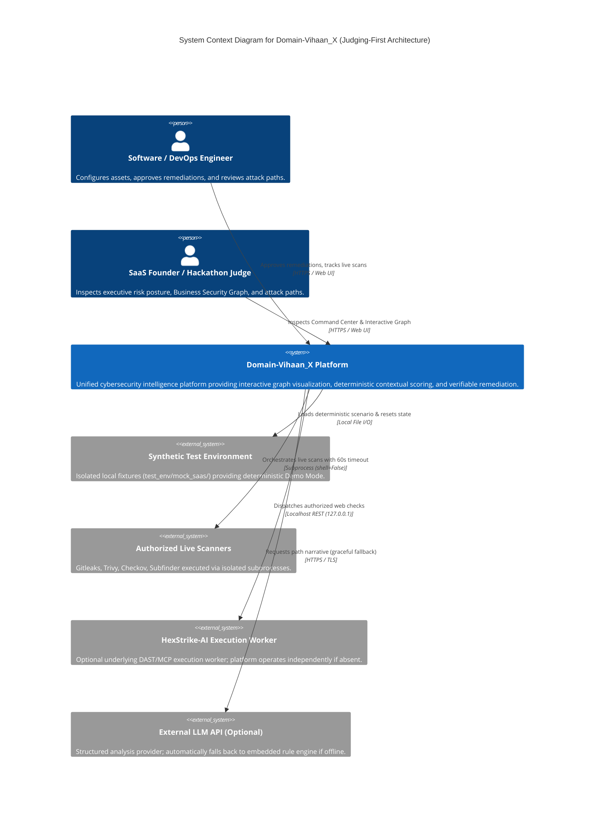
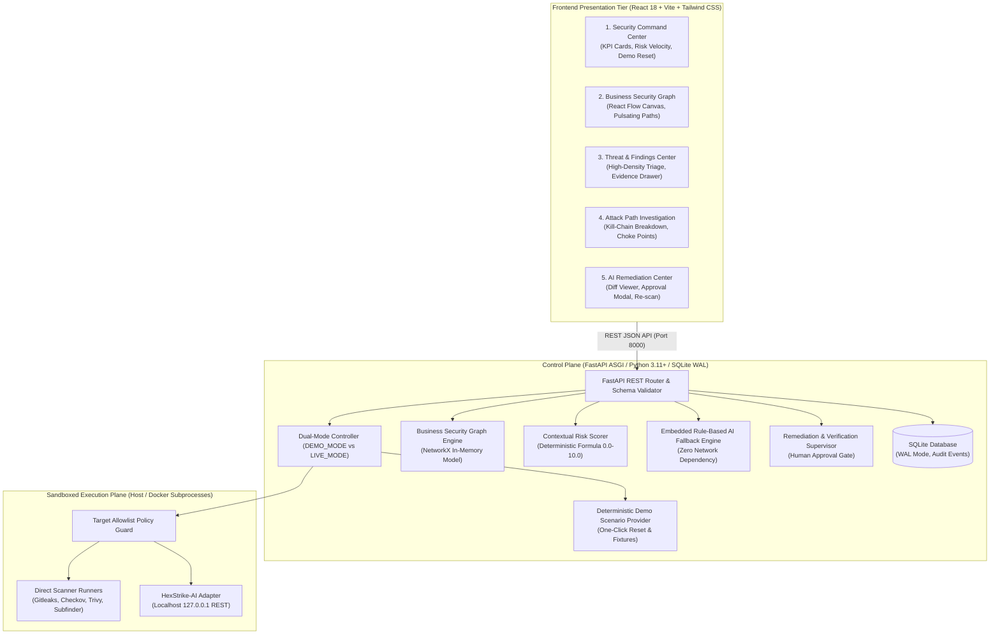
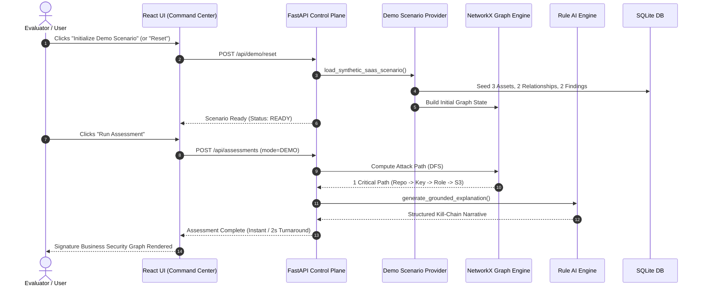
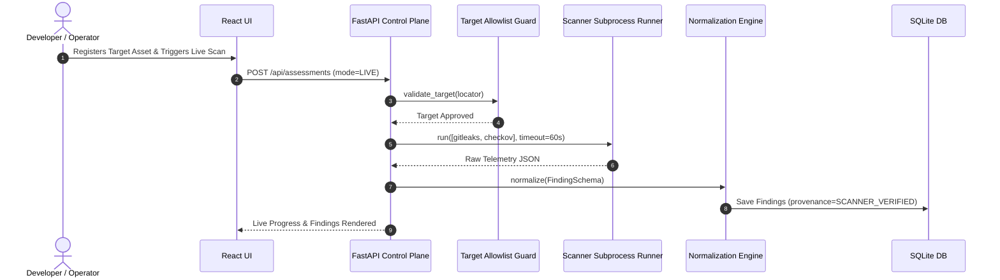
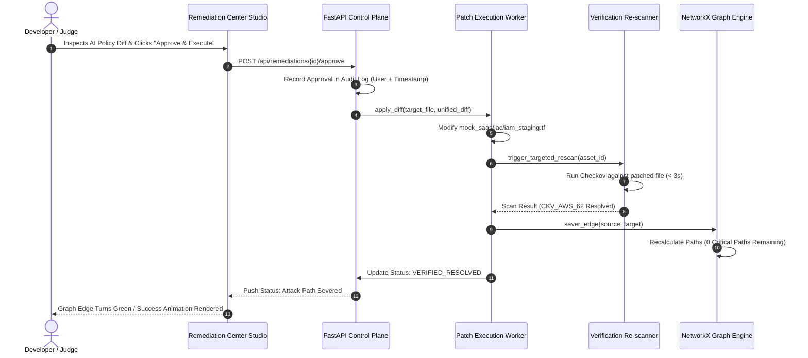

# System Architecture Blueprint — Domain-Vihaan_X

> **Document ID:** ARCH-001  
> **Project Name:** Domain-Vihaan_X  
> **Domain:** Cybersecurity (VIHAAN X Hackathon)  
> **Document Status:** PROPOSED (Updated for Judging-First & Dual-Mode Strategy)  
> **Author:** Principal Software Architect & Cybersecurity Lead  
> **Last Updated:** 2026-11-15T00:24:00+05:30  
> **Target Release:** Hackathon MVP (v0.1.0)  
> **Core Strategic Philosophy:** **Frontend-first. Backend-reliable. Demo-driven.**  

---

## 1. High-Level Architectural Model (C4 Level 1: System Context)

The system context diagram illustrates how users, evaluators, and external security environments interact with **Domain-Vihaan_X**:



---

## 2. Container Diagram (C4 Level 2: Platform Containers)

The platform is strictly organized into three distinct tiers: the **Five-Interface Frontend Layer**, the **Dual-Mode Resilient Control Plane**, and the **Isolated Sandboxed Execution Plane**:



---

## 3. Dual-Mode Operational Data Flows

### 3.1 Demo Mode Data Flow (Deterministic & Offline)


### 3.2 Live Assessment Mode Data Flow (Real Tools)


---

## 4. Resilience & Graceful Degradation Architecture

```
┌────────────────────────────────────────────────────────────────────────┐
│                        RESILIENCE SUPERVISORY MATRIX                   │
├───────────────────────────────┬────────────────────────────────────────┤
│ Failure Scenario              │ Autonomous Degradation Action          │
├───────────────────────────────┼────────────────────────────────────────┤
│ 1. HexStrike Service Down     │ Adapter detects `ConnectionRefused`;   │
│                               │ logs warning; dispatches native CLI    │
│                               │ runners; platform operates seamlessly. │
├───────────────────────────────┼────────────────────────────────────────┤
│ 2. External LLM Timeout (> 5s)│ Timeout guard aborts remote HTTP call; │
│    or Internet Disconnection  │ invokes embedded `RuleBasedAI` engine; │
│                               │ returns structured narrative card.     │
├───────────────────────────────┼────────────────────────────────────────┤
│ 3. Scanner Binary Hanging     │ Subprocess supervisor issues `SIGKILL` │
│                               │ at 60s; marks `ScanExecution(TIMED_OUT)│
│                               │ preserves partial results in DB.       │
├───────────────────────────────┼────────────────────────────────────────┤
│ 4. Corrupted Scanner JSON     │ Quarantines malformed string in DB;    │
│                               │ normalizer continues parsing valid     │
│                               │ tool outputs without crashing.         │
├───────────────────────────────┼────────────────────────────────────────┤
│ 5. Browser Refresh During Scan│ UI polling hook (`useScanStatus`)      │
│                               │ reads live state from SQLite; restores │
│                               │ progress bar seamlessly.               │
├───────────────────────────────┼────────────────────────────────────────┤
│ 6. Remediation Fix Incomplete │ Automated re-scan detects finding still│
│                               │ present; sets `REMEDIATION_INCOMPLETE` │
│                               │ keeps attack edge red; alerts user.    │
└───────────────────────────────┴────────────────────────────────────────┘
```

---

## 5. Signature Feature: The Business Security Graph

The **Business Security Graph** is the central visual centerpiece evaluated by hackathon judges.

### Visual Architecture & React Flow Styling
- **Node Classification:**
  - `AssetNode`: Renders digital assets with type icon (`Repository`, `CloudStorage`, `IAMRole`, `Domain`), environment badge (`Production`, `Staging`), and criticality indicator.
  - `FindingNode`: Renders vulnerability cards with severity badge (`Critical: Crimson`, `High: Amber`), rule identifier, and contextual risk score.
- **Edge Classification:**
  - `OperationalEdge`: Solid subtle line representing normal infrastructure dependencies (`DEPLOYS_TO`, `STORES_DATA_IN`).
  - `AttackEdge`: **Pulsating Red Animated Edge** indicating an active, exploitable kill chain.
  - `SeveredEdge`: **Solid Emerald Green Edge** indicating a verified, remediated relationship.
- **Interactive Capabilities:**
  - Interactive drag, pan, zoom, and minimap navigation.
  - Clicking any node opens the **Inspector Drawer** displaying deep metadata and evidence provenance.
  - Clicking an attack path in the sidebar automatically focuses and zooms the canvas onto the active kill chain.

---

## 6. Closed-Loop Remediation Architecture


