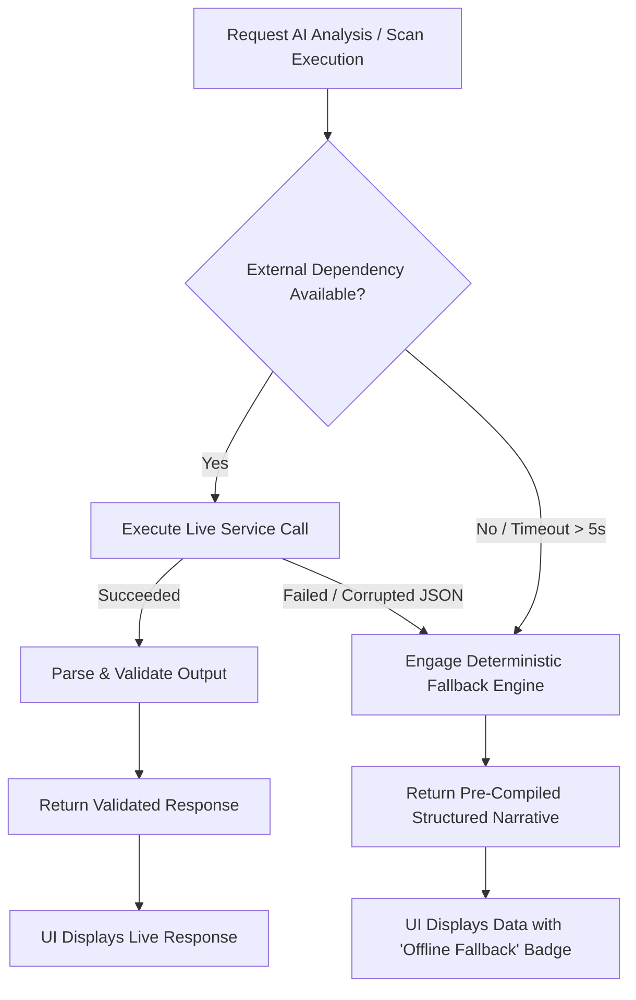

# Technical Implementation Specification — Domain-Vihaan_X

> **Document ID:** TECH-001  
> **Project Name:** Domain-Vihaan_X  
> **Domain:** Cybersecurity (VIHAAN X Hackathon)  
> **Document Status:** PROPOSED (Updated for Judging-First & Dual-Mode Strategy)  
> **Author:** Principal Software Architect & Cybersecurity Architect  
> **Last Updated:** 2026-11-15T00:22:00+05:30  
> **Target Release:** Hackathon MVP (v0.1.0)  
> **Core Strategic Philosophy:** **Frontend-first. Backend-reliable. Demo-driven.**  

---

## 1. Technical Overview

**Domain-Vihaan_X** is architected as an asynchronous, decoupled, multi-tier intelligence system. It ingests heterogeneous security findings from code repositories, cloud infrastructure, and network attack surfaces, normalizes them into a unified finding model, maps them onto a directed property graph, evaluates composite multi-hop attack paths, and provides human-approved remediation verified by automated reassessment.

Under our **Frontend-first, Backend-reliable, Demo-driven** architecture:
- **Frontend Presentation Layer:** Centers on five polished, enterprise-grade cybersecurity interfaces, with the interactive **Business Security Graph** serving as the signature visual differentiator.
- **Backend Control Plane:** Prioritizes predictability, determinism, and graceful degradation under adverse conditions (offline operation, missing external LLMs, or HexStrike unavailability).
- **Dual Operating Modes:** Operates in either **Demo Mode** (deterministic synthetic test environment, zero internet/LLM dependency, one-click reset) or **Live Assessment Mode** (authorized live scanner execution with verified source provenance).

---

## 2. Technology Selections and Stack Rationale

```
┌────────────────────────────────────────────────────────────────────────┐
│                        FRONTEND PRESENTATION LAYER                     │
│  React 18 + Vite + TypeScript + Tailwind CSS + React Flow (@xyflow)    │
│  (5 Primary Interfaces: Command Center, Graph, Threats, Paths, Studio) │
└───────────────────────────────────┬────────────────────────────────────┘
                                    │ JSON / REST API (OpenAPI 3.1)
┌───────────────────────────────────▼────────────────────────────────────┐
│                         BACKEND CONTROL PLANE                          │
│     Python 3.11+ / FastAPI (ASGI) / Pydantic V2 / NetworkX / SQLite    │
│  ┌──────────────────────────────────┐┌───────────────────────────────┐ │
│  │ Demo Scenario Provider & Reset   ││ Live Scanner Orchestrator     │ │
│  └──────────────────────────────────┘└───────────────────────────────┘ │
│  ┌──────────────────────────────────┐┌───────────────────────────────┐ │
│  │ Deterministic Rule AI Fallback   ││ Target Allowlist Policy Guard │ │
│  └──────────────────────────────────┘└───────────────────────────────┘ │
└───────────────────────────────────┬────────────────────────────────────┘
                                    │ Local Subprocess / Unix Socket
                                    │ (Sanitized, Parameterized CLI Args)
┌───────────────────────────────────▼────────────────────────────────────┐
│                    EXECUTION PLANE & SCANNER ADAPTERS                  │
│       Gitleaks + Trivy + Checkov + HexStrike-AI Hardened Adapter       │
└────────────────────────────────────────────────────────────────────────┘
```

### Proposed Stack Specifications

| Layer | Selected Technology | Version | Rationale & Selection Criteria | Status |
| :--- | :--- | :--- | :--- | :--- |
| **Frontend Framework** | React | `^18.3.1` | Declarative UI, industry standard for dashboard applications, optimal component ecosystem. | PROPOSED |
| **Build & Dev Tool** | Vite | `^5.4.0` | Sub-second HMR, native ES modules, lightweight production bundling. | PROPOSED |
| **Language (Web)** | TypeScript | `^5.5.0` | Strict type safety for complex graph data structures and API payloads. | PROPOSED |
| **Styling & Design** | Tailwind CSS | `^3.4.0` | Rapid, consistent enterprise-grade cybersecurity styling; zero CSS bloat. | PROPOSED |
| **Graph Visualization** | React Flow (`@xyflow/react`) | `^12.0.0` | Battle-tested interactive node-and-edge canvas; customizable nodes, minimap, controls, and edge animations. | PROPOSED |
| **Iconography** | Lucide React | `^0.400.0` | Clean, modern vector icons for security indicators. | PROPOSED |
| **Backend Framework** | FastAPI | `^0.111.0` | Native async Python ASGI, automated OpenAPI documentation generation, high throughput. | PROPOSED |
| **Data Validation** | Pydantic V2 | `^2.7.0` | Rust-based parsing core, rigorous type validation, seamless JSON serialization. | PROPOSED |
| **Graph Processing** | NetworkX | `^3.3.0` | In-memory directed graph algorithms: shortest path, cycle detection, all simple paths, and centrality. | PROPOSED |
| **Database Engine** | SQLite (WAL Mode) | `3.45+` | Zero-configuration, file-based persistence for hackathon MVP; strict concurrency handling via Write-Ahead Logging (WAL). | PROPOSED |
| **Security Execution** | Gitleaks / Checkov / Trivy | Latest CLI | Industry-standard open-source security linters and scanners. | PROPOSED |
| **Sec Execution Bridge** | HexStrike-AI Adapter | Custom | Hardened Python client accessing HexStrike endpoints with target allowlists and argument sanitization. | PROPOSED |

---

## 3. Core Architecture Principles

1. **Frontend-First Presentation & UX Polish:**  
   The UI is the primary judging medium. It must exhibit enterprise-grade aesthetics (dark slate themes, crisp status badges, refined monospace typography for code/diffs, responsive loading skeletons, and interactive graph exploration).
2. **Backend Reliability & Graceful Degradation:**  
   The backend must never crash or leave the frontend in an indefinite loading state. If an external service (LLM, HexStrike, network) fails, the platform degrades immediately to deterministic local logic without error modals.
3. **Dual Operating Modes (Demo vs. Live):**  
   The platform clearly separates synthetic demonstration capabilities (`DEMO_MODE`) from production scanner execution (`LIVE_ASSESSMENT_MODE`). Simulated data is explicitly tagged to maintain truth in evidence.
4. **Decoupled Control & Execution Planes:**  
   The web server must never invoke raw shell scripts or execute unvalidated user commands. Scanners operate as isolated worker jobs with explicit execution timeouts, memory bounds, and exit code trapping.
5. **Schema Uniformity & Provenance Mandate:**  
   All scanner outputs normalize into uniform `FindingSchema` objects carrying explicit source provenance (`SCANNER_VERIFIED`, `SIMULATED_DEMO`, `CONFIG_DERIVED`).
6. **Deterministic Risk Calculations:**  
   Algorithmic risk scoring must be 100% mathematical and reproducible. AI is used solely for explanatory synthesis, with a mandatory offline rule-based fallback.
7. **Human Authority & Verifiable Remediation:**  
   Any state change in infrastructure requires explicit human approval. Remediation status is verified exclusively through automated re-assessment.

---

## 4. The Five Primary Frontend Interfaces

The frontend application architecture is structured into five cohesive primary views:

```
┌────────────────────────────────────────────────────────────────────────┐
│                        FIVE PRIMARY FRONTEND INTERFACES                │
├───────────────────────────────┬────────────────────────────────────────┤
│ View Component                │ Technical Responsibilities             │
├───────────────────────────────┼────────────────────────────────────────┤
│ 1. Security Command Center    │ Executive KPI metrics (Aggregate Risk  │
│    (`src/views/CommandCenter`)│ Score, Open Vulnerabilities, Active    │
│                               │ Paths), Operating Mode indicator, and  │
│                               │ one-click demo scenario reset button.  │
├───────────────────────────────┼────────────────────────────────────────┤
│ 2. Business Security Graph    │ SIGNATURE VISUAL FEATURE: Full React   │
│    (`src/views/SecurityGraph`)│ Flow canvas, custom AssetNode and      │
│                               │ FindingNode cards, animated kill-chain │
│                               │ edges, minimap, and node inspector.    │
├───────────────────────────────┼────────────────────────────────────────┤
│ 3. Threat and Findings Center │ High-density triage table with keyword │
│    (`src/views/ThreatCenter`) │ search, category tabs (Secret, IaC,    │
│                               │ SCA), severity badges, and raw evidence│
│                               │ slide-out drawer.                      │
├───────────────────────────────┼────────────────────────────────────────┤
│ 4. Attack Path Investigation  │ In-depth kill chain inspection drawer  │
│    (`src/views/PathInspect`)  │ detailing hop-by-hop transitions,      │
│                               │ choke-point calculation, and AI risk   │
│                               │ explanation narrative.                 │
├───────────────────────────────┼────────────────────────────────────────┤
│ 5. AI Remediation Center      │ Remediation studio displaying unified  │
│    (`src/views/Remediation`)  │ policy diffs, human approval dialog,   │
│                               │ live re-scan execution progress, and   │
│                               │ verified edge-severed state badge.     │
└───────────────────────────────┴────────────────────────────────────────┘
```

---

## 5. Dual Operating Mode Architecture

```mermaid
flowchart TD
    subgraph ModeSwitch ["Global Mode Selector"]
        M[User / Evaluation Mode]
    end

    subgraph DemoModePath ["Demo Mode (Deterministic & Offline)"]
        D1[Demo Scenario Provider] --> D2[Synthetic SaaS Fixtures<br/>/test_env/mock_saas/]
        D2 --> D3[Deterministic Normalizer]
        D3 --> D4[Graph Engine<br/>(Seeded Topology)]
        D4 --> D5[Embedded Rule AI Fallback<br/>(Zero Network Required)]
    end

    subgraph LiveModePath ["Live Assessment Mode (Real Execution)"]
        L1[Target Allowlist Guard] --> L2[Subprocess Scanner Orchestrator]
        L2 --> L3[Real Tools: Gitleaks, Checkov, Trivy]
        L3 --> L4[Live Normalization Engine]
        L4 --> L5[Graph Engine + External LLM API]
    end

    M -- "DEMO_MODE" --> D1
    M -- "LIVE_ASSESSMENT_MODE" --> L1

    D4 --> UI[Unified React UI<br/>(5 Primary Interfaces)]
    L5 --> UI
```

### 5.1 Demo Mode
- **Purpose:** Flawless, 100% reproducible live presentation for hackathon evaluators.
- **Data Source:** Managed synthetic SaaS test environment located at `test_env/mock_saas/`.
- **Guarantees:** Zero dependence on external LLM APIs, zero internet access required, sub-5-second execution turnaround.
- **One-Click Reset (`POST /api/demo/reset`):** Flushes SQLite database tables, re-seeds default assets, and restores modified Terraform files to original vulnerable state. Allows repeating the demonstration at will.
- **Provenance Labeling:** All findings, relationships, and attack paths carry `provenance="SIMULATED_DEMO"`.

### 5.2 Live Assessment Mode
- **Purpose:** Production-grade security assessment against authorized real-world digital assets.
- **Data Source:** Dynamic execution of Gitleaks, Checkov, Trivy, and Subfinder against user-specified targets.
- **Guarantees:** Strict target allowlist enforcement, real process monitoring, partial-result preservation, and scanner availability diagnostics.
- **Provenance Labeling:** All findings carry `provenance="SCANNER_VERIFIED"` with exact tool name, exit code, and execution duration.

---

## 6. Resilience & Graceful Degradation Engine

The Control Plane implements an explicit resilience hierarchy to ensure that failures in auxiliary tools never impair the core demonstration:



### Graceful Degradation Behaviors:
1. **HexStrike Unavailable:** Control Plane logs `INFO: HexStrike unavailable. Operating in native CLI mode.` Core platform continues without interruption.
2. **External LLM Timeout (> 5s) / Disconnect:** `app/ai/rule_fallback.py` synthesizes a deterministic, rule-based natural language explanation based on finding categories and target criticality.
3. **Scanner Subprocess Timeout (> 60s):** Subprocess supervisor issues `SIGKILL`, records `ScanExecution(status=TIMED_OUT)`, and preserves partial findings.
4. **Corrupted Scanner Output:** Quarantined in `quarantine_logs/` table without throwing an unhandled 500 exception.
5. **Browser Refresh:** Frontend state is fully restored on reload via idempotent API queries to SQLite.

---

## 7. Business Security Graph Construction & Attack-Path Detection

The platform represents security infrastructure as a directed property graph:
$$G = (V, E)$$

Where:
- $V = V_{\text{asset}} \cup V_{\text{finding}}$
  - $V_{\text{asset}}$ represents digital assets (`REPOSITORY`, `CLOUD_STORAGE`, `IAM_ROLE`, `DOMAIN`, `WEB_SERVICE`).
  - $V_{\text{finding}}$ represents vulnerabilities, secrets, and misconfigurations attached to assets.
- $E$ represents directed operational and exploit relationships (`AFFECTS`, `DEPLOYS_TO`, `ASSUMES_ROLE`, `STORES_DATA_IN`, `EXPOSES_ENDPOINT`, `AUTHENTICATES_VIA`).

### Attack-Path Traversal Algorithm

Attack paths are computed using a directed path search over the constructed graph:
1. Identify all **Ingress Nodes** ($V_{\text{ingress}} \subseteq V$): Assets exposed to the perimeter (e.g., public domains, publicly cloneable repositories).
2. Identify all **Target High-Value Nodes** ($V_{\text{target}} \subseteq V$): Assets marked with `criticality = HIGH | CRITICAL` (e.g., production databases, storage buckets holding PII).
3. Execute depth-first search (DFS) with cycle detection to identify all elementary paths $P = (v_1, v_2, \dots, v_k)$ from $v_1 \in V_{\text{ingress}}$ to $v_k \in V_{\text{target}}$ such that intermediate edges represent viable operational or privilege links.
4. Filter paths to retain only those containing at least one unmitigated `Vulnerability` or `Secret` node.
5. Identify **Choke Points**: Graph nodes that appear across multiple attack paths whose remediation severs several exploit trajectories simultaneously.

---

## 8. Context-Aware Risk-Scoring Methodology

Raw CVSS scores are insufficient because they ignore asset criticality and network exposure. Domain-Vihaan_X computes a deterministic **Contextual Risk Score (CRS)**:

$$\text{CRS}(F) = \min\left(10.0, \, \left(\text{BaseSeverity}(F) \times W_{\text{asset}} \times W_{\text{exposure}}\right) + \text{PathBonus}(F)\right)$$

Where:
- $\text{BaseSeverity}(F)$: Numeric mapping based on CVSS / tool severity (`CRITICAL: 9.0`, `HIGH: 7.0`, `MEDIUM: 4.5`, `LOW: 2.0`, `INFO: 0.5`).
- $W_{\text{asset}}$: Criticality multiplier based on asset environment and business classification:
  - `PRODUCTION`: $1.3$
  - `STAGING`: $1.0$
  - `TESTING / DEV`: $0.7$
- $W_{\text{exposure}}$: Network exposure multiplier:
  - `PUBLIC_INTERNET`: $1.4$
  - `INTERNAL_NETWORK`: $1.0$
  - `ISOLATED / AIRGAPPED`: $0.6$
- $\text{PathBonus}(F)$: Added exploitability weight:
  - $+2.0$ if the finding lies on an active, verified multi-hop attack path.
  - $+0.0$ if the finding is isolated and has no reachability to other assets.

---

## 9. Remediation Architecture & Verification Loop

Remediation operates through a controlled state machine:

```
[ PENDING_ANALYSIS ]
        │
        ▼
[ RECOMMENDATION_GENERATED ] ──(Review)──► [ REJECTED ]
        │
        ▼ (Human Approval Gate)
[ APPROVED ]
        │
        ▼
[ EXECUTING_FIX ]
        │
        ▼
[ REASSESSING ]
   ├──(Vulnerability Cleared)──► [ RESOLVED & SEVERED ]
   └──(Vulnerability Persists)─► [ REMEDIATION_INCOMPLETE ]
```

### Synthetic Test Remediation Mechanics
For the hackathon demonstration, remediation modifies a local synthetic manifest file (e.g., updating a test Terraform IAM file from `Resource: *` to an explicit scoped bucket ARN).
1. **Diff Generation:** Generates a unified diff preview displayed in the UI.
2. **Approval Gate:** The API endpoint `POST /api/remediations/{id}/approve` records the approver's identity and timestamp.
3. **Patch Application:** The remediation worker applies the diff to the local mock repository.
4. **Automated Reassessment:** The scanner orchestrator re-executes Checkov/Trivy against the modified file.
5. **Graph Verification:** The Graph Engine recalculates the attack path. When the edge is severed, the finding is marked `RESOLVED` and the attack path is marked `SEVERED`.

---

## 10. Database Strategy (SQLite in WAL Mode)

The Hackathon MVP utilizes **SQLite** configured in **Write-Ahead Logging (WAL) Mode**:
- `PRAGMA journal_mode=WAL;`
- `PRAGMA busy_timeout=5000;`
- `PRAGMA foreign_keys=ON;`

### Why SQLite for Hackathon MVP?
- **Zero External Dependencies:** Eliminates Docker orchestration headaches during rapid hackathon live demonstrations.
- **ACID Compliance & Concurrency:** WAL mode supports concurrent readers without blocking the single writer process.
- **One-Click Reset:** Entire database can be reseeded instantaneously via `app/db/init_db.py`.
- **PostgreSQL Compatibility:** All SQL tables and Pydantic ORM models use standard SQL types (`TEXT`, `INTEGER`, `REAL`, `JSONB` via JSON strings) ensuring an effortless transition to PostgreSQL for production v1.0.

---

## 11. Local Development Runbook

```bash
# 1. Clone repository
git clone https://github.com/bhavyab212/Domain-Vihaan_X.git
cd Domain-Vihaan_X

# 2. Setup Python backend virtualenv
cd backend
python -m venv venv
# Windows:
.\venv\Scripts\activate
# Linux/macOS:
source venv/bin/activate
pip install -r requirements.txt

# 3. Initialize SQLite DB with Synthetic Demo Data
python -m app.db.init_db --seed-synthetic-demo

# 4. Start FastAPI Control Plane
uvicorn app.main:app --host 127.0.0.1 --port 8000 --reload

# 5. Start React Frontend (in separate terminal)
cd ../frontend
npm install
npm run dev -- --port 3000
```
